<p align="center">
  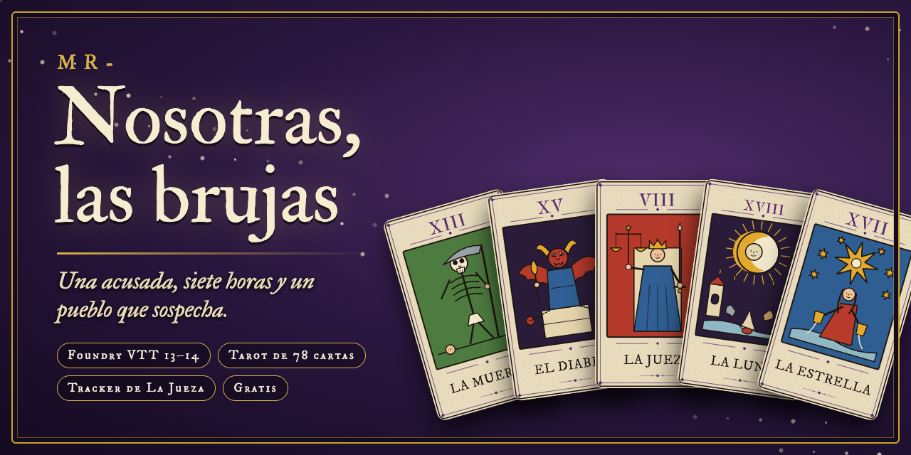
</p>

<p align="center">
  <a href="https://github.com/ManuRomera/mr-nosotras-las-brujas/releases/latest"></a>
  
  
  
</p>

<h3 align="center">Un pueblo pequeño, una Hermana acusada y siete horas para descubrir quién la está envenenando con sospechas.</h3>

<p align="center">
  El juego de rol narrativo de <b>Hernán D'Andreis</b> y <b>Keith Monardes</b> (<a href="https://primigenia-austral.itch.io/nosotras-las-brujas">Primigenia Austral</a>), listo para jugar en Foundry VTT: <b>tarot completo de 78 cartas</b>, el <b>mesa de La Jueza</b> que te dice qué toca hacer, sospechas boca abajo, Laudes y seguridad en mesa.
</p>

<p align="center">
  <a href="https://github.com/ManuRomera/mr-nosotras-las-brujas/releases/latest/download/mr-nosotras-las-brujas.zip"></a>
  &nbsp;
  <a href="https://manuromera.github.io/mr-nosotras-las-brujas/"></a>
</p>

---

## Instalar en 20 segundos

En Foundry: **Configuración → Sistemas de juego → Instalar sistema**, pega el manifiesto y pulsa *Instalar*. Se actualiza desde ahí mismo cada vez que haya versión nueva.

```
https://github.com/ManuRomera/mr-nosotras-las-brujas/releases/latest/download/system.json
```

> **Necesitas el manual del juego.** Este sistema es una ayuda de mesa: automatiza el ritual (cartas, escenas, recuento), no sustituye al libro. Consíguelo en [itch.io](https://primigenia-austral.itch.io/nosotras-las-brujas).

## El tarot, hecho a mano

Las **78 cartas** son de xilografía a color, con el arcano, el número y el nombre en la propia carta: ilustraciones propias para los 22 mayores, los 16 cortes y los 4 ases; los demás menores llevan sus glifos de palo, con el número exacto. Los 19 mayores y los 56 menores son mazos de Foundry; La Estrella, El Sol y La Luna son los marcadores de las horas.

<p align="center">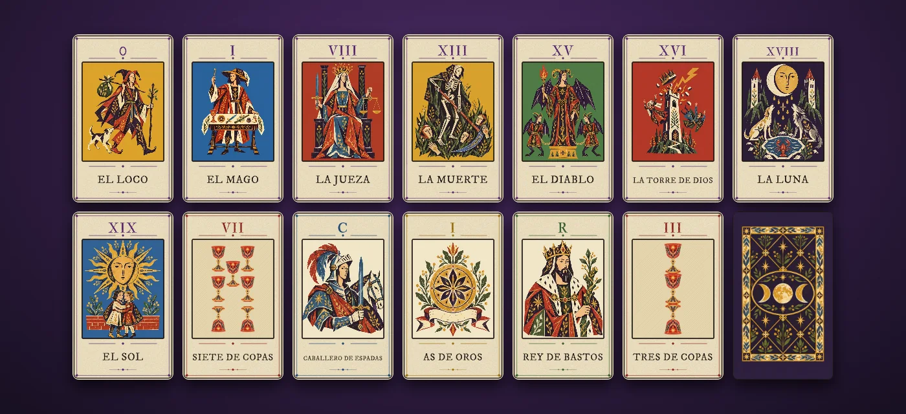</p>

> **Pasa el cursor por cualquier carta** (chat, mesa, fichas, mazos) y se amplía en toda su magnitud.

## La mesa de La Jueza: toda la pantalla, siempre sabes qué toca

<p align="center">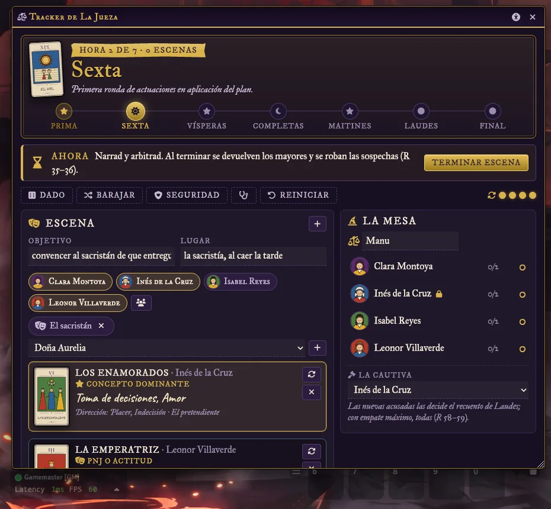</p>

<p align="center">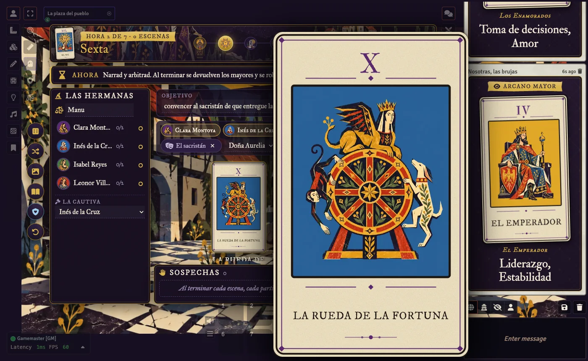<br><sub>Pasa el cursor por una carta y se amplía en toda su magnitud.</sub></p>

- **Tira de las siete horas** (Prima, Sexta, Vísperas, Completas, Maitines, Laudes y Final) con su marcador; campanadas al cambiar.
- **«Ahora»**: una barra que propone el siguiente paso con su botón. Abre escena, elige quién actúa, roba los mayores, termina, pasa de hora, revela en Laudes y publica la sentencia.
- **Escena**: objetivo, lugar y PNJ; el mayor de cada Hermana ordenado por número —dominante, segundo, detalle— con el concepto a la vista y la inversión de La Jueza (una por Hermana, sin recuperarlas).
- **Sospechas**: la primera de cada Hermana se conserva y la segunda se entrega boca abajo, con destinataria propuesta. Nadie la mira hasta Laudes.
- **Laudes**: revela, suma —lo entregado suma a quien lo recibe— y acusa al máximo; con empate, a todas. Avisa si falta alguien por robar.
- **Prima**: sorteo de vínculos (y quién empieza) y cuenta atrás de diez minutos para el recuerdo.

<p align="center">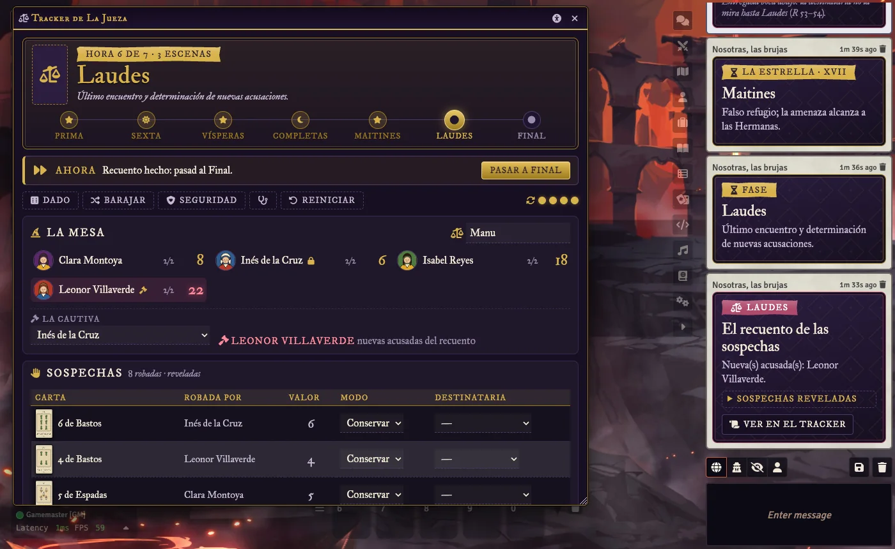</p>

## Fichas con papel y tinta

**Hermana**, **PNJ** y **Pueblo**: las frases de la hoja, los vínculos con la carta del arcano a la vista (y su pregunta con el nombre ya puesto), las sospechas robadas y recibidas, sello de *Acusada* o *La cautiva*, retrato en arco con encuadre (diez retratos propios para empezar), estampa de tinta de «Acusada» y «La cautiva", modo compacto y memoria de posición. Con **modo oscuro** si lo prefieres.

<p align="center">
  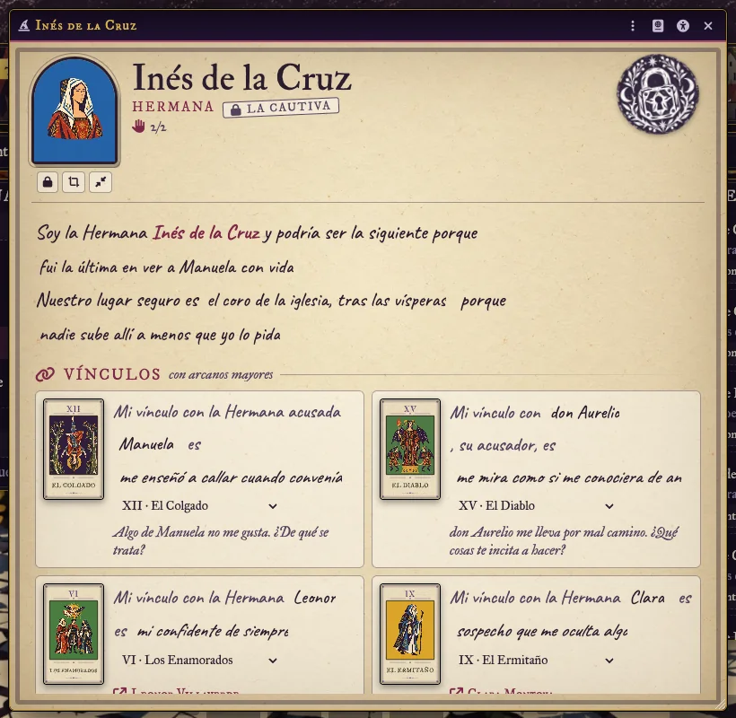
  &nbsp;
  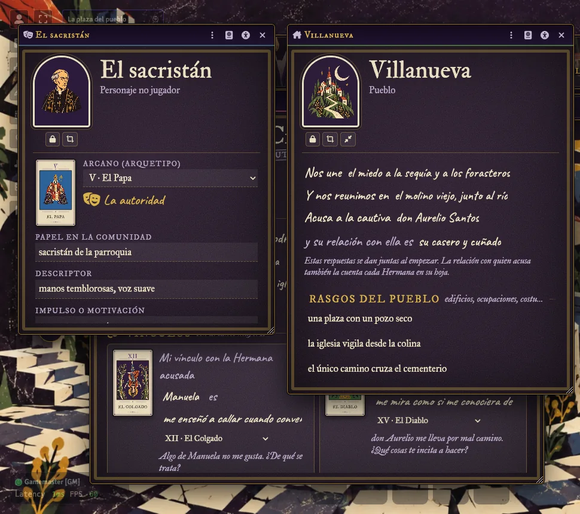
</p>

## Escenarios listos

Un compendio con **8 escenas** ilustradas (la plaza, la iglesia, la sacristía, el molino viejo, la ermita, el bosque, el camino del cementerio y el calabozo) para mostrar a la mesa. El botón de la imagen de la mesa activa la que quieras para toda la mesa, y un ajuste la cambia sola con cada hora.

<p align="center">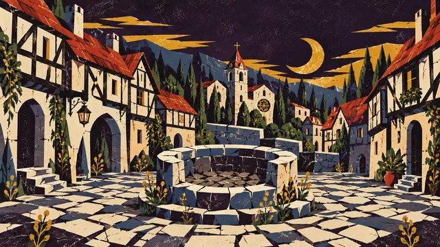 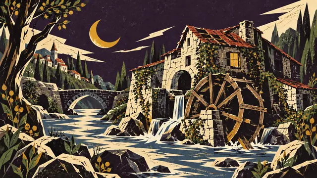 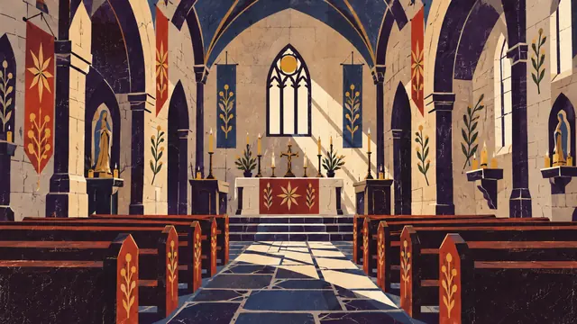</p>

## Tutorial guiado

La primera vez, el sistema te ofrece un **tutorial guiado** (como el de Foundry): un paseo por la mesa, las fichas y las cartas para quien dirige, y otro para las Hermanas. Lo encuentras en Configuración → Tutorial guiado y en Configuración → Tours.

## Pensado para jugar con cuidado

La partida trata de persecución, misoginia y ejecución. El botón **Seguridad** abre **Pausa**, **Velo** y **Tarjeta X** —anónimas, a toda la mesa al instante— y las **líneas y velos** acordados.

<p align="center">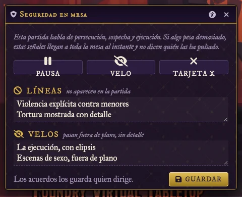</p>

Además: icono de **accesibilidad** en cada ventana (tamaño del texto, alto contraste, modo oscuro, fuente de alta legibilidad, sin movimiento), **sonido ambiente** sintetizado (opcional) y un **diagnóstico** que revisa mazos, imágenes y partida y deja un informe para copiar.

## Ajustes que importan

El dossier de reglas marca varios puntos «a verificar con el original»; el sistema los deja a tu mesa en lugar de decidirlos:

| Ajuste | Para qué |
|---|---|
| Valores de las figuras | Sota, Caballero, Dama y Rey (11–14 por defecto) |
| Robos por Hermana | Dos por defecto: una para conservar y otra para entregar |
| Destinatarias | Solo otras Hermanas, o también la acusada inicial |
| Dado opcional de 1d6 | Las seis respuestas de La Jueza |

## Para quien quiera mirar dentro

```bash
npm run check    # sintaxis, JSON, rutas, 78 cartas y plantillas
npm test         # reglas puras (node:test)
npm run build    # compila las ayudas a packs/ (con Foundry cerrado)
npm run tarot    # recompone las 78 cartas (marco, numeral, nombre e ilustración)
npm run arte     # importa un zip de arte nuevo (ver scripts/importar-arte.py)
```

Foundry 13 y 14 con `ApplicationV2`, `TypeDataModel` y un único `module/compat.mjs` para lo que cambia entre versiones. La auditoría de reglas y automatismos está en [`docs/AUDITORIA.md`](docs/AUDITORIA.md); los cambios, en [`CHANGELOG.md`](CHANGELOG.md).

## Créditos y licencia

*Nosotras, las brujas* es de **Hernán D'Andreis** y **Keith Monardes**, con ilustraciones de Ferenike, publicado por **Primigenia Austral**. Este sistema es una implementación no oficial de **Manu Romera** y no tiene relación con la editorial: si lo piden, se retira. Ver [`NOTICE.md`](NOTICE.md).

El código y el arte son [MIT](LICENSE); el arte se generó con IA a partir de una dirección de arte propia, sin material de terceros; las tipografías IM Fell y Caveat, [OFL](fonts/OFL.txt).

<p align="center"><sub>MR- · Manu Romera · Digital RPG Design</sub></p>
