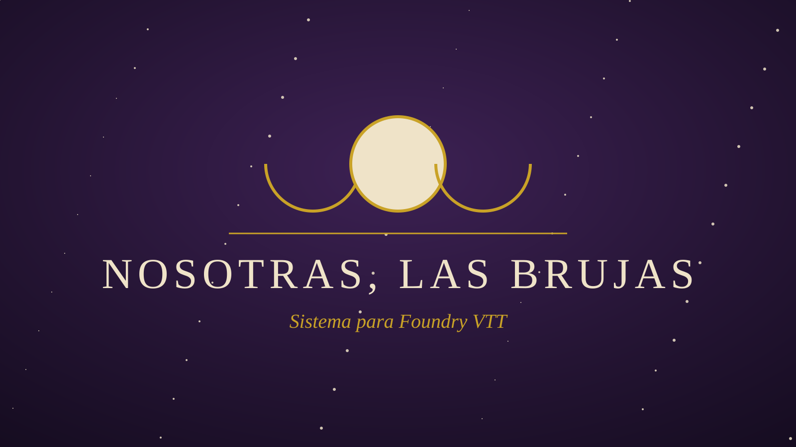
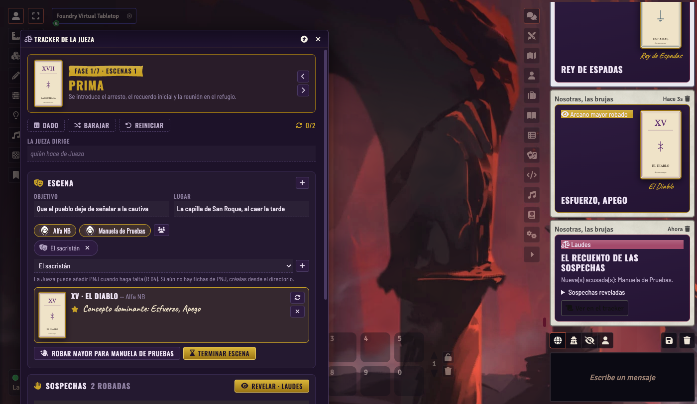
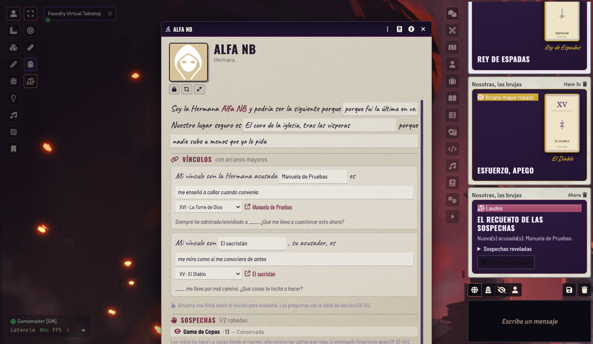
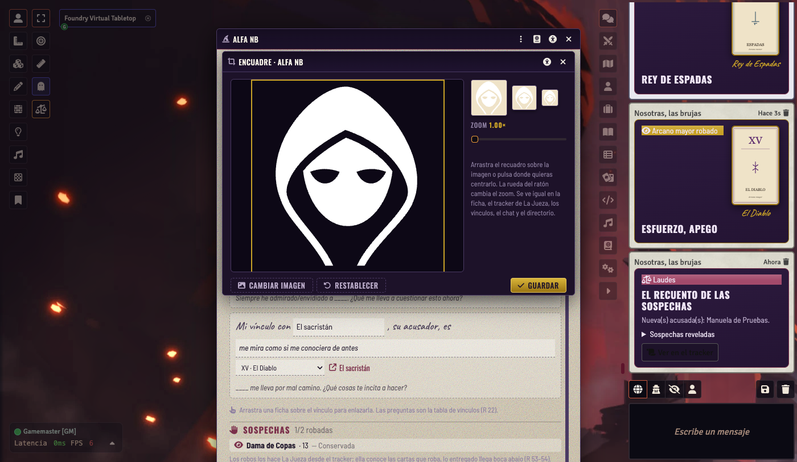
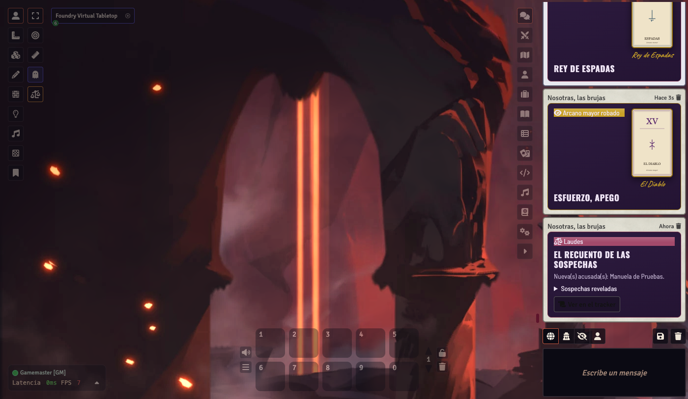
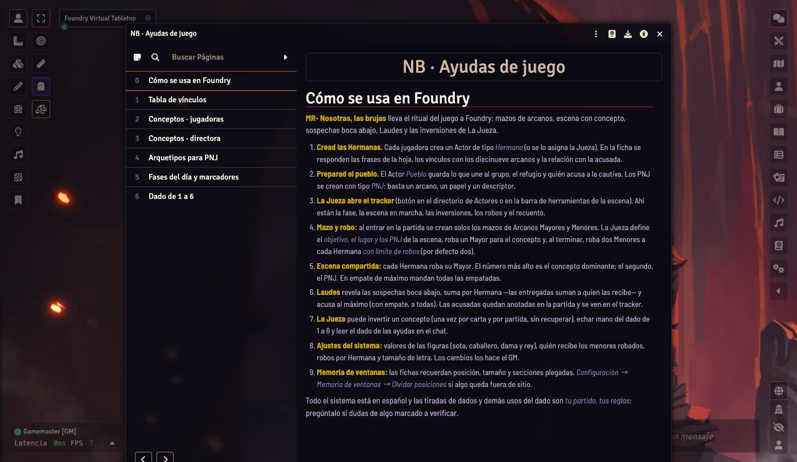

# MR- Nosotras, las brujas



**Sistema para Foundry VTT de _Nosotras, las brujas_, el juego de rol de Primigenia Austral.**
Un pueblo pequeño, una Hermana acusada y siete fases de día para descubrir quién
la está envenenando con sospechas. Las cartas mandan: arcanos mayores como
conceptos de escena, arcanos menores como sospechas que suman.

> Quien tiene el mayor número, dicta el concepto de la escena.

<br clear="right">

## Instalar

En Foundry: *Configuración → Sistemas de juego → Instalar sistema* y pega el manifiesto:

```
https://github.com/ManuRomera/mr-nosotras-las-brujas/releases/latest/download/system.json
```

Foundry VTT **13** o **14**. Probado en 13.351; lo que cambia entre versiones
está aislado en [`module/compat.mjs`](module/compat.mjs).

## Qué trae

### Fichas
- **Hermana**: las frases de la hoja («Soy la Hermana… y podría ser la siguiente
  porque…», el lugar seguro), vínculos con los diecinueve arcanos —al elegir el
  arcano se rellena su pregunta de la tabla (R 22)— con enlace a la ficha de la
  Hermana enlazada, sus sospechas robadas y recibidas (con el límite de robos) y
  notas.
- **PNJ**: arcano que le da su arquetipo, papel, descriptor, impulso y notas.
- **Pueblo**: lo que une al grupo, el refugio, quién acusa a la cautiva y su
  relación, y los rasgos del pueblo.
- Candado de edición, **modo compacto**, **encuadre del retrato** y memoria de
  posiciones, pestañas y secciones plegadas.

### Mazos y escena
- **Arcanos Mayores** (19) y **Menores** (56) como mazos de Foundry con arte del
  sistema; se crean solos al entrar en la partida.
- **Escena en marcha**: objetivo, lugar y PNJ; la Jueza roba el Mayor del
  concepto, se narra y al terminar roba dos Menores a cada Hermana **con límite
  de robos** (2 por defecto, ajustable).
- **Escena compartida**: cada Hermana roba su Mayor; el número más alto es el
  concepto dominante y el segundo el PNJ. En empate de máximo mandan todas.
- **Sospechas boca abajo** hasta **Laudes**, que las revela, suma por Hermana
  —las entregadas a una destinataria suman para ella (R 53–54)— y acusa al
  máximo (en empate, a todas). El modo (conservar o entregar) y la destinataria
  se eligen en el tracker, con las reglas del ajuste **destinatarias**.

### Tracker de La Jueza
- La **fase del día** (Prima → Sexta → Vísperas → Completas → Maitines → Laudes
  → Final) con su marcador (Estrella, Sol o Luna) y anuncio en el chat.
- Escena en marcha, participantes, PNJ, robo de Mayores, **inversiones de La
  Jueza** (una por carta, límite = nº de Hermanas, sin recuperar), recuento de
  Laudes y reinicio.
- **Dado opcional de 1 a 6** (Sí, pero… / No y además…) con su tabla.
- Solo el GM puede usarlo; el resto de la mesa puede abrirlo **en solo lectura**
  (sin valores, destinatarias ni recuento).

### Compendio y ajustes
- **Ayudas de juego**: cómo se usa el sistema en Foundry, tabla de vínculos,
  conceptos de jugadoras y de directora, arquetipos de PNJ, fases y dado.
- Ajustes: **valores de las figuras** (sota, caballero, dama, rey),
  **destinatarias** de las cartas entregadas (otras Hermanas, o también la
  acusada inicial), **robos por Hermana** y tamaño de letra.

### Accesibilidad
- Icono de **accesibilidad** en la cabecera de todas las ventanas: tamaño de
  texto, alto contraste, fuente de alta legibilidad y reducir movimiento.
- **Encuadre del retrato** igual en ficha, chat y directorio.

## Capturas

**Tracker de La Jueza** — fase del día, escena en marcha con su concepto
dominante, sospechas robadas y el recuento de Laudes en el chat:

<p align="center"></p>

**Ficha de Hermana** — las frases de la hoja, los vínculos con su pregunta de
arcano y las sospechas robadas y recibidas:

<p align="center"></p>

**Encuadre del retrato** — el mismo editor de recorte en ficha, chat, tracker y
directorio:

<p align="center"></p>

**Chat** — cartas de robo boca abajo y tarjeta de Laudes con el recuento:

<p align="center"></p>

**Ayudas de juego** — el manual dentro de Foundry, con su índice:

<p align="center"></p>

## Desarrollo

```bash
npm run check   # sintaxis, JSON y rutas
npm test        # reglas puras (node:test)
npm run build   # genera _data/ayudas.json y compila _data/*.json → packs/
npm run tarot   # regenera el arte de las 78 cartas y los marcadores
npm run zip     # empaqueta el sistema para publicar (Foundry cerrado)
```

Los compendios se generan desde `_data/`; `packs/` no se versiona.
El contenido del manual es © de sus autores: este sistema es para uso personal.

## Licencia

Código bajo [MIT](LICENSE).
